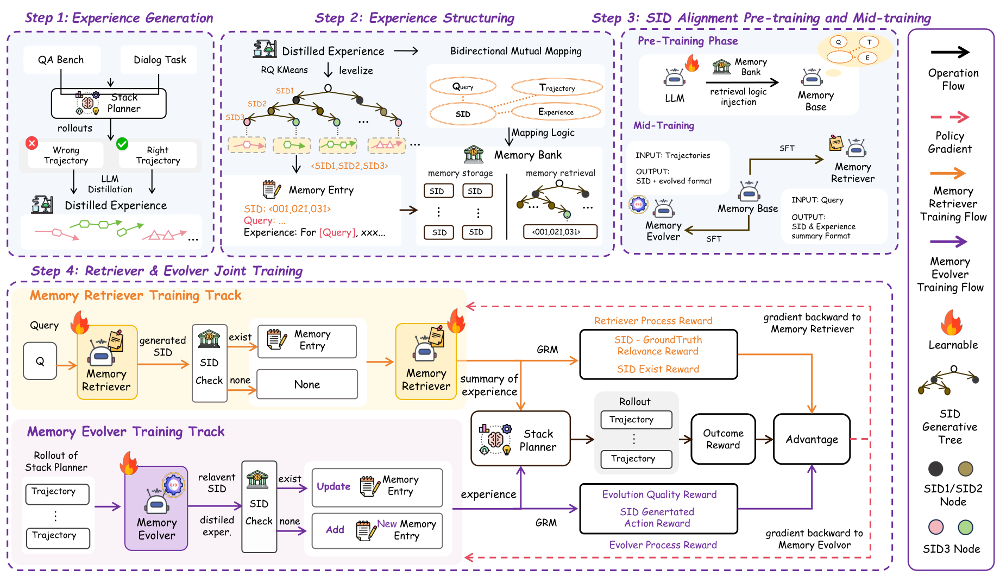

<div align="center">
  
# GenMem

### Generative Symbolic Memory for Self-Evolving Harness

[](https://arxiv.org/abs/2609.34633)
[](assets/GenMen_method%284%29%281%29.pdf)
[](https://huggingface.co/chuchuxwx/GenMem)

Official implementation of [GenMem](https://arxiv.org/pdf/2609.34633).

</div>

GenMem assigns stable, four-token symbolic identifiers (SIDs) to reusable experiences. MemRetriever retrieves experience through these addresses, while MemEvolver updates the experience stored at an address without changing the address itself.



## Repository layout

```text
embedding/               Experience embeddings
quantization/            Weighted RQ-KMeans and memory-to-SID encoding
LlamaFactory/
  src/                   Fixed-version LlamaFactory source
  pt/                    SID alignment and summary preparation
  mt/                    CoT generation and mid-training data
  configs/               PT, summary, MT, and DeepSpeed configurations
verl/
  verl/                  Modified verl training source
  recipe/genmem/         GRPO data, rewards, tool loops, and launchers
evolution/               Offline MemR -> solver -> MemE memory evolution
configs/                 Shared SID and prompt configurations
```

Download [MemRetriever, MemEvolver, the 48 × 16 × 8 × 8 codebook, and the QA/ALFWorld/WebShop server LoRAs](https://huggingface.co/chuchuxwx/GenMem) from Hugging Face. To train the task-solving server model, follow [Harness-RL](https://github.com/jiangxinke/Harness-RL), the framework used in our experiments.

## Installation

Use Python 3.10+ and a PyTorch build compatible with your CUDA driver:

```bash
git clone https://github.com/chichuxwx/GenMem.git
cd GenMem
pip install -r requirements.txt
```

Both training frameworks are included as source. For PT/MT, `requirements-pt.txt` installs the local `LlamaFactory/` package; for GRPO, `requirements-rl.txt` installs the local `verl/` package. Use separate training environments; see [installation and training instructions](docs/TRAINING.md). Offline evolution requires a task-solving model or service; the paper's server-model training uses Harness-RL.

## Use the released codebook

Download only the small codebook files; the encoder downloads the pinned Qwen3-Embedding-0.6B model on first use:

```bash
hf download chuchuxwx/GenMem --include 'codebook/*' --local-dir quantization
python -m quantization.encode_memory \
  --memory 'When a tool fails, inspect the error and retry with corrected arguments.' \
  --device cuda
```

The output contains four SID codes and their token string. Keep the released embedding model, instruction, and codebooks together: training a new codebook changes the SID assignment.

## Train with your own data

Run the commands below from the GenMem repository root. Replace example data and checkpoint paths in `LlamaFactory/configs/` for PT/MT, or configure `verl/recipe/genmem/config/` for GRPO.

### 1. Build embeddings and SIDs

`experiences.jsonl` contains one `{"sample_id": "...", "experience_text": "..."}` object per line:

```bash
python -m embedding.build_embeddings \
  --input private_data/experiences.jsonl \
  --output private_data/embeddings.jsonl --device cuda
python -m quantization.train_rqk \
  --input private_data/embeddings.jsonl --output artifacts/codebook
```

This writes four codebooks, `config.json`, and `sid_mapping.json`. To continue with a new SID vocabulary, use `LlamaFactory/pt/expand_sid_vocab.py` and `configs/sid_vocab.json`.

### 2. SID alignment pretraining

`LlamaFactory/pt/prepare_stage_a_raw_bidir_pt.py` builds bidirectional text↔SID examples and a LlamaFactory `dataset_info.json`. It expects the three prepared source files named in `SOURCE_SPECS`, plus a general-text JSON file. The released training config then runs with:

```bash
llamafactory-cli train LlamaFactory/configs/pt.yaml
```

Next, merge experiences sharing a SID with `LlamaFactory/pt/merge_memory_bank.py`. The script includes the Qwen3-32B summarization prompt, concurrent requests, and resumable checkpoints. Use `LlamaFactory/pt/build_summary_data.py` to construct summary ↔ SID examples, then train with `LlamaFactory/configs/summary_initial.yaml`. For summaries produced in later batches, use `LlamaFactory/configs/summary.yaml`. Follow the [summary preparation guide](LlamaFactory/pt/README.md) for commands and dataset registration.

### 3. MemRetriever / MemEvolver CoT mid-training

We use **DeepSeek V4 Flash** to generate the CoT supervision. First, prepare teacher inputs from your raw and merged memory banks:

```bash
python LlamaFactory/mt/build_cot_generation_inputs.py \
  --raw-bank private_data/raw_bank.json \
  --merged-bank private_data/merged_bank.json \
  --memr-output private_data/memr_teacher_input.json \
  --meme-output private_data/meme_teacher_input.json
```

For **MemRetriever**, use two teacher calls per example: generate `thinking` for the query, then generate `rewritten_exp` conditioned on the query and retrieved experience. For **MemEvolver**, generate `thinking` from the query and execution trajectory; retain the merged summary as the `evo_exp` target. MemE examples cover both updating an existing experience and filling an empty SID.

Use `LlamaFactory/mt/generate_teacher_cot.py` for concurrent teacher requests and resume support. It retains the original `source_index` and input fields. The two `stitch_*` scripts recover SIDs and assemble tool-call conversations; then run `retarget_memr_rl_prompt.py` to align MemR with its RL prompt. Follow the [MT data guide](LlamaFactory/mt/README.md) for the output schema, assembly commands, validation, and LlamaFactory dataset registration. Train the resulting datasets with `LlamaFactory/configs/mt_memr.yaml` and `LlamaFactory/configs/mt_meme.yaml`.

### 4. GRPO post-training

`verl/recipe/genmem/build_training_data.py` and `verl/recipe/genmem/build_meme_training_data.py` prepare the two RL datasets. The launchers are `verl/recipe/genmem/run_memr.sh` and `verl/recipe/genmem/run_meme.sh`. They require MT checkpoints, a memory bank, a patched verl environment, and an external task-outcome service. See `verl/recipe/genmem/config/local_config_v33.sh` for the required environment variables; no credentials are stored here.

## Offline memory evolution

The released [QA/search server LoRA](https://huggingface.co/chuchuxwx/GenMem/tree/main/server_qa_lora) is checkpoint 159 on **Qwen2.5-7B-Instruct** (rank 16, alpha 32). Load it with the base tokenizer and route StackPlanner2's Central actor to the adapted model; specialist roles use the frozen base. See the [adapter loading guide](https://huggingface.co/chuchuxwx/GenMem/blob/main/server_qa_lora/README.md). It is separate from the Qwen3-8B MemRetriever and MemEvolver.

Interactive adapters share the same base and LoRA dimensions: [ALFWorld step 65](https://huggingface.co/chuchuxwx/GenMem/blob/main/server_alfworld_lora/README.md) runs as **Interactor** with Central frozen; [WebShop step 66](https://huggingface.co/chuchuxwx/GenMem/blob/main/server_webshop_lora/README.md) uses **Central** in historical evaluation. The WebShop guide documents the training-harness provenance limitation. Follow each adapter's loading and routing instructions rather than swapping roles between tasks.

The offline loop runs MemRetriever, passes its retrieved experience to a solver, then applies gated MemEvolver updates and saves memory-bank snapshots. With a local OpenAI-compatible solver, a starting bank, and the released agent checkpoints:

```bash
hf download chuchuxwx/GenMem --include 'memr/*' 'meme/*' --local-dir models
export SP_BACKEND=direct_llm
export DIRECT_LLM_URL=http://127.0.0.1:8000/v1
export DIRECT_LLM_MODEL=your-solver-model
python evolution/offline_evo.py \
  --dataset private_data/queries.jsonl \
  --memory_bank private_data/memory_bank.json \
  --memr_model models/memr --meme_model models/meme \
  --output_dir outputs/evolution --num_iters 3 \
  --inference_backend transformers --tensor_parallel_size 1
```

The query file accepts JSON/JSONL rows with `question`, optional `ground_truth_answer`, and `dataset`. For a minimal starting bank, `memory_bank.json` may be a JSON object mapping a complete four-token SID to its experience text. `python evolution/offline_evo.py --help` lists beam retrieval, reranking, lazy updates, and resume options. The `direct_llm` adapter is a portable way to run the loop; reproducing paper results requires the corresponding task harness and server model.

## Citation

```bibtex
@article{jiang2026genmem,
  title={GenMem: Generative Symbolic Memory for Self-Evolving Harness},
  author={Jiang, Xinke and Feng, Tao and Xu, Weixuan and Zhang, Zhixin and Yang, Zhibang and Zhang, Wentao and Zhu, Runchuan and Chu, Xu and Zhao, Junfeng and Wang, Yasha},
  journal={arXiv preprint arXiv:2609.34633},
  year={2026}
}
```

## License

Apache-2.0. Third-party model and dependency licenses apply separately.
